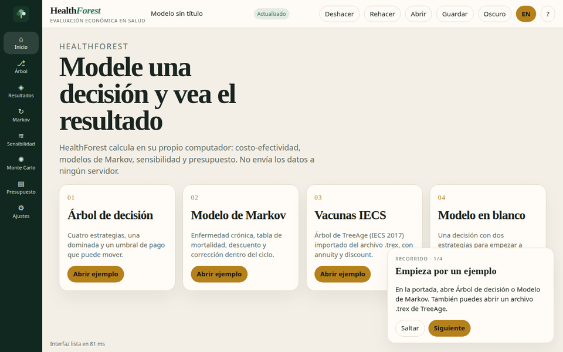

# HealthForest

Un programa libre para evaluar costos y resultados en salud. Dibujas un árbol o un modelo de Markov y ves el costo, los años de vida ajustados por calidad y el resultado incremental. Todo ocurre en tu computador: no hay cuenta y tus modelos no se envían a ningún servidor.

## Elige cómo abrirlo

No necesitas Python, Node ni permisos de administrador.

| Si quieres… | Haz esto |
| --- | --- |
| Probarlo ya | Pulsa **Usar en línea**. |
| Tenerlo en el escritorio | Pulsa **Descargar instalador** y abre el archivo de tu sistema. |
| Una carpeta que funciona sin internet | Pulsa **Descargar ZIP**, descomprímela y haz doble clic en `Abrir HealthForest.html`. |

## Tres pasos

1. Abre HealthForest con una de las tres opciones de arriba.
2. En la portada, pulsa **Abrir ejemplo** en **Árbol de decisión**.
3. Entra a **Resultados**. Ahí ves el costo, el efecto y el RCEI.

La primera vez aparece un recorrido corto. Puedes saltarlo. El botón **?** vuelve a abrirlo y lista las guías.

Las guías, con capturas, están en [docs/guia](docs/guia/es/index.md): tu primer árbol, Markov, sensibilidad, Monte Carlo, presupuesto, importar TreeAge y exportar figuras. También hay un [glosario](docs/guia/es/glosario.md) y [preguntas frecuentes](docs/guia/es/preguntas.md).

Si el doble clic no abre el navegador, los archivos de la carpeta `launch` solo abren ese mismo HTML. Son opcionales.

## Qué puedes hacer

- Dibujar un árbol de izquierda a derecha: decisión, azar, terminal, Markov, lógico y clon. Zoom, minimapa y ruta óptima.
- Usar `#` para la probabilidad que falta, pagos, variables y fórmulas (`discount`, `annuity`, tablas con `nombre[edad]`).
- Ver el rollback, la tabla incremental, el RCEI, la dominancia fuerte y la extendida, la frontera y el beneficio neto.
- Armar un Markov de cohorte: recompensas inicial, incremental y final, medio ciclo, corrección dentro del ciclo, Simpson, túneles, `_stage` y `_age`, tablas, descuento y traza.
- Ver el diagrama de estados y el costo de cada periodo, y exportarlo a CSV.
- Correr una microsimulación con semilla, rastreadores y remuestreo.
- Hacer sensibilidad de una vía, tornado, dos vías y umbral.
- Correr Monte Carlo (beta, gamma, lognormal, normal, uniforme, triangular, Dirichlet y normal multivariada), con plano, CEAC, CEAF, EVPI y una estimación de EVPPI.
- Calcular el impacto presupuestal: población, adopción, mundo actual y mundo nuevo.
- Usar supervivencia particionada, simulación por eventos y un modelo infeccioso sencillo (SIR).
- Calibrar un parámetro a un objetivo.
- Poner pagos en nodos intermedios y leer el informe de caminos.
- Importar un archivo `.trex` de TreeAge (árbol o Markov, con tablas y distribuciones).
- Cambiar el tema (claro, oscuro o de publicación) y exportar el árbol a SVG, PNG y PDF.
- Guardar tu modelo como `.healthforest.json` y volver a abrirlo.

La interfaz abre en español. **EN** la pasa al inglés.

## Citarlo

Si usas HealthForest en un trabajo, cita el archivo [CITATION.cff](CITATION.cff).

Licencia MIT. Copyright 2026 Daniel Uribe.

Si algo falla o quieres una función, abre un issue en GitHub. Hay plantillas para errores y para ideas.

---

# HealthForest

A free program for weighing costs and health outcomes. You draw a tree or a Markov model and see the cost, the quality-adjusted life years and the incremental result. Everything runs on your computer: there is no account, and your models are not uploaded.

## Pick how to open it

You do not need Python, Node or an administrator password.

| If you want… | Do this |
| --- | --- |
| To try it now | Click **Use online**. |
| An icon on your desktop | Click **Download installer** and open the file for your system. |
| A folder that works offline | Click **Download ZIP**, unzip it and double-click `Abrir HealthForest.html`. |

## Three steps

1. Open HealthForest with one of the three choices above.
2. On the welcome screen, click **Open example** on **Decision tree**.
3. Open **Results**. You will see the cost, the effect and the ICER.

The first time, a short tour appears. You can skip it. The **?** button starts it again and lists the guides.

Illustrated guides are in [docs/guia](docs/guia/en/index.md): your first tree, Markov, sensitivity, Monte Carlo, budget impact, TreeAge import and figure export. There is also a [glossary](docs/guia/en/glossary.md) and an [FAQ](docs/guia/en/faq.md).

If a double-click does not open the browser, the files in `launch` only open that same HTML file. They are optional.

## What you can do

Draw a left-to-right tree (decision, chance, terminal, Markov, logic and clone) with zoom, a minimap and the optimal path. Use `#` for the missing probability, payoffs, variables and formulas (`discount`, `annuity`, tables as `name[age]`). See rollback, the incremental table, the ICER, strong and extended dominance, the frontier and net benefit. Build a cohort Markov model with initial, incremental and final rewards, half-cycle correction, within-cycle correction, Simpson integration, tunnels, `_stage` and `_age`, tables, discounting and a trace. Open the state diagram and the cost of each period, and export that table as CSV. Run a seeded microsimulation with trackers and bootstrap resampling. Run one-way, tornado, two-way and threshold sensitivity. Run Monte Carlo (beta, gamma, lognormal, normal, uniform, triangular, Dirichlet and multivariate normal) with the CE plane, CEAC, CEAF, EVPI and a binned EVPPI estimate. Build a budget-impact analysis. Use partitioned survival, discrete-event simulation and a simple infectious-disease (SIR) model. Calibrate one parameter to a target. Put payoffs on intermediate nodes and read the pathway report. Import a TreeAge `.trex` file (a tree or a Markov model, with tables and distributions). Switch the theme (light, dark or publication) and export the tree as SVG, PNG or PDF. Save your model as `.healthforest.json` and open it again.

The interface opens in Spanish. **EN** switches it to English.

## Citing it

If you use HealthForest in a paper, cite [CITATION.cff](CITATION.cff).

MIT License. Copyright 2026 Daniel Uribe.

If something breaks, or you want a feature, open a GitHub issue. There are templates for bug reports and feature requests.
