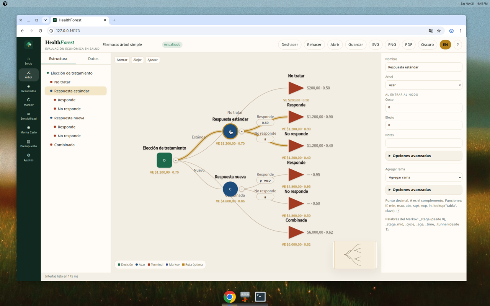
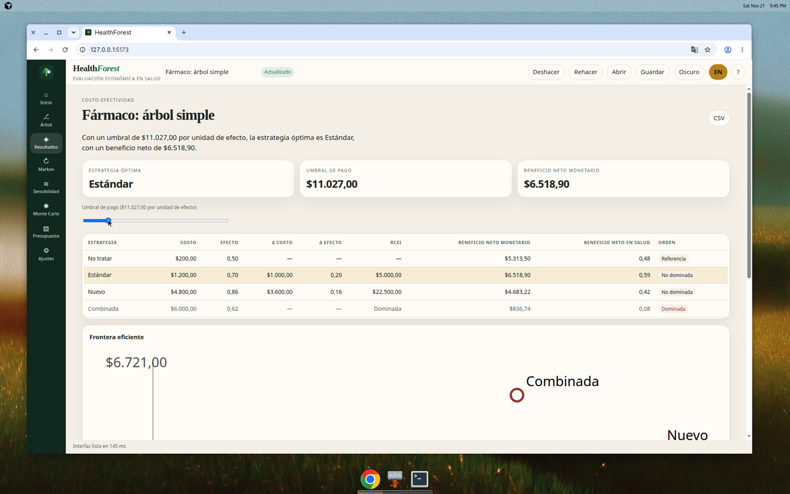
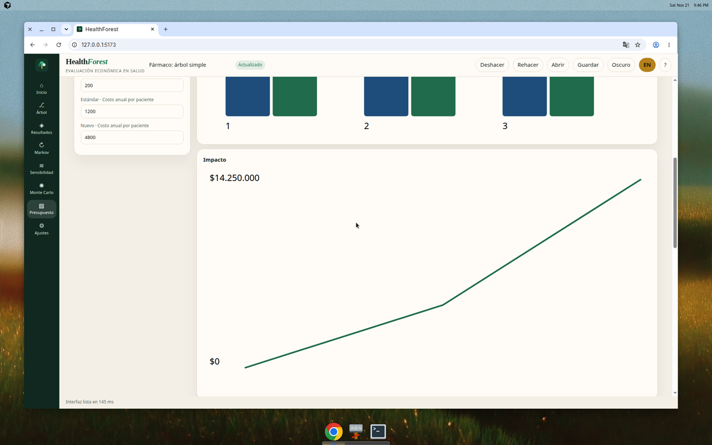

# HealthForest

Programa libre para evaluación económica en salud: árboles de decisión, modelos de Markov, costo-efectividad, sensibilidad y presupuesto. Los cálculos ocurren en el navegador. No hay servidor y los modelos no salen del equipo.








## Cómo abrirlo

Hace falta un navegador actual (Chrome, Edge, Firefox o Safari). No hace falta instalar Node para usar la copia ya construida.

1. Descargue el repositorio como ZIP (Código → Download ZIP) y descomprímalo.
2. En esa carpeta, abra `launch`:
   - Windows: doble clic en `Abrir HealthForest.bat` (usa Python, que viene en muchas instalaciones; si no está, instale Python 3 desde python.org).
   - macOS: doble clic en `Abrir HealthForest.command`.
   - Linux: `./launch/Abrir HealthForest.sh`.
3. Se abre `http://127.0.0.1:4173`. En la portada elija **Árbol de decisión** o **Modelo de Markov**.
4. Guarde su trabajo con **Guardar**. El archivo `.healthforest.json` se puede volver a abrir y compartir.

La interfaz está en español. El botón **EN** pasa al inglés. El pie de página muestra cuánto tardó en quedar lista la interfaz.

También se puede publicar en GitHub Pages: en el repositorio, Settings → Pages → Source: GitHub Actions. El flujo `.github/workflows/pages.yml` publica la carpeta `dist` en cada cambio de `main`.

### Instalador de escritorio

Los instaladores de Windows, macOS y Linux se generan al publicar una etiqueta `v*` (por ejemplo `v0.1.0`) con el flujo `.github/workflows/release.yml` (Tauri). Quedan como borrador en GitHub Releases. El perfil de compilación recorta y compacta el binario. El peso del instalador lo marca sobre todo el visor web del sistema, no el modelo: la aplicación en sí pesa unos cientos de kilobytes.

Quien compile en su máquina necesita Node 22, Rust y las librerías de Tauri 2. Luego: `npm ci`, `npm run build` y `npm run tauri:build` si tiene la CLI de Tauri (`npx @tauri-apps/cli build`).

## Qué puede hacer ahora

- Dibujar un árbol de izquierda a derecha: decisión, azar, terminal, Markov, lógico y clon.
- Probabilidad `#` como complemento, pagos de costo y efecto, variables y fórmulas.
- Rollback, tabla incremental, RCEI, dominancia fuerte y extendida, frontera, umbral de pago y beneficio neto.
- Markov de cohorte: recompensas inicial / incremental / final, corrección dentro del ciclo, Simpson, túneles, `_stage` y `_age`, tablas, descuento y traza.
- Microsimulación con semilla, rastreadores y distribuciones por paciente (en un hilo aparte, con barra de progreso y cancelar).
- Sensibilidad de una vía, tornado, dos vías y umbral.
- Monte Carlo de segundo orden (beta, gamma, lognormal, normal, uniforme, triangular, Dirichlet, normal multivariada y más), plano, CEAC, CEAF, EVPI y una estimación de EVPPI.
- Presupuesto al estilo ISPOR: población, adopción, mundo actual y nuevo, impacto anual y acumulado, sensibilidad.
- Temas claro, oscuro y de publicación. Exportar el árbol a SVG, PNG y PDF, y las tablas a CSV.
- Tres ejemplos: un árbol simple, una enfermedad crónica y el árbol de vacunas IECS 2017 importado de TreeAge (`.trex`). La comparación con las cuentas hechas a mano está en [docs/validation.md](docs/validation.md).

El mapa de lo que falta para parecerse del todo a TreeAge Pro está en [docs/treeage-parity.md](docs/treeage-parity.md).

## Para quien programa

```bash
npm ci
npm test
npm run dev
npm run build
```

El motor está en `src/engine` y no depende de React. Los tests comparan rollback, RCEI, Markov (con descuento, WCC y túnel), microsimulación, Monte Carlo con semilla y presupuesto contra cuentas hechas a mano.

La carga inicial (gzip) es aproximadamente: HTML 0,4 KB, CSS 2,9 KB y JavaScript 105 KB. Gráficos de resultados, Markov, sensibilidad, Monte Carlo y presupuesto van en otro archivo de unos 9 KB gzip y solo se bajan al abrir esa pantalla. El worker de simulación (41 KB sin comprimir) se descarga al pulsar Simular. En esta máquina la interfaz quedó lista en 145 ms.

Licencia MIT. Copyright 2026 Daniel Uribe.

---

# HealthForest

A free program for health economic evaluation: decision trees, Markov models, cost-effectiveness, sensitivity analysis and budget impact. Every calculation runs in the browser. There is no server, and models stay on your computer.

## How to open it

You need a current browser. You do not need Node to use the prebuilt copy.

1. Download the repository as a ZIP and unzip it.
2. In the `launch` folder:
   - Windows: double-click `Abrir HealthForest.bat` (it uses Python 3).
   - macOS: double-click `Abrir HealthForest.command`.
   - Linux: `./launch/Abrir HealthForest.sh`.
3. The app opens at `http://127.0.0.1:4173`. On the welcome screen, open the decision-tree example or the Markov example.
4. Use **Save** to download a `.healthforest.json` file you can open again or share.

The interface starts in Spanish. **EN** switches it to English.

GitHub Pages: in the repository, Settings → Pages → GitHub Actions. The workflow publishes `dist` on every push to `main`.

Desktop installers for Windows, macOS and Linux are built when a `v*` tag is pushed (`.github/workflows/release.yml`, Tauri) and uploaded as a draft GitHub Release. The release build is stripped and size-optimised. Installer size is dominated by the system web view; the app assets themselves are a few hundred kilobytes.

## What works in this version

Decision trees (decision, chance, terminal, Markov, logic, clone), complement probabilities, formulas, rollback, ICERs, strong and extended dominance, the efficient frontier, willingness to pay and net benefit. Cohort Markov models with initial, incremental and final rewards, within-cycle correction, Simpson integration, tunnels, `_stage` and `_age`, lookup tables, discounting and a trace. Seeded microsimulation in a worker, with progress and cancel. One-way, tornado, two-way and threshold sensitivity. Second-order Monte Carlo with the usual distributions, plus the CE plane, CEAC, CEAF, EVPI and a binned EVPPI estimate. An ISPOR-style budget impact module. Light, dark and publication themes. SVG, PNG, PDF and CSV export. Three examples, including an IECS 2017 vaccine tree imported from TreeAge. The comparison is in [docs/validation.md](docs/validation.md).

The gap to full TreeAge Pro parity is listed in [docs/treeage-parity.md](docs/treeage-parity.md).

## For developers

```bash
npm ci
npm test
npm run dev
npm run build
```

The calculation engine lives in `src/engine` and does not import React. Tests check rollback, ICERs, Markov discounting and within-cycle correction, microsimulation, seeded Monte Carlo and budget impact against hand-calculated values.

First load, gzipped: HTML 0.4 KB, CSS 2.9 KB, JavaScript 105 KB. Result charts and the Markov, sensitivity, Monte Carlo and budget screens are a separate 9 KB (gzip) chunk, loaded only when opened. The simulation worker (41 KB uncompressed) loads only when you press Simulate. On this machine the interface reported ready in 145 ms.

MIT License. Copyright 2026 Daniel Uribe.
