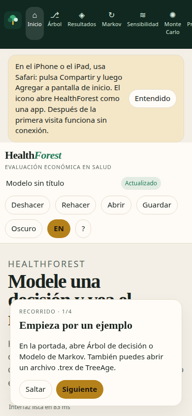

# Cómo tener HealthForest en el iPhone o el iPad

No se puede instalar un archivo de app en el iPhone sin la App Store. Apple no deja ese paso. Lo que sí puedes hacer es guardar la página en la pantalla de inicio. Se abre a pantalla completa y, después de la primera visita, funciona sin conexión.

Usa **Safari**. Chrome en el iPhone no muestra esta opción.

1. Abre Safari.
2. Entra a https://daurpa01.github.io/healthforest/
   - Si Daniel publicó la carpeta `app` de estas descargas en su sitio, usa esa dirección en su lugar. Tiene que ser una página web (https), no un archivo que te enviaron por correo.
3. Pulsa el botón **Compartir** (el cuadrado con la flecha hacia arriba).
4. Baja y pulsa **Agregar a pantalla de inicio**.
5. Pulsa **Agregar**.
6. Abre HealthForest desde el icono nuevo.

La primera vez necesitas internet. Cuando el icono ya cargó la página, puedes usarla después sin red.

Dentro de la página, si estás en el iPhone, también ves estas mismas instrucciones.

