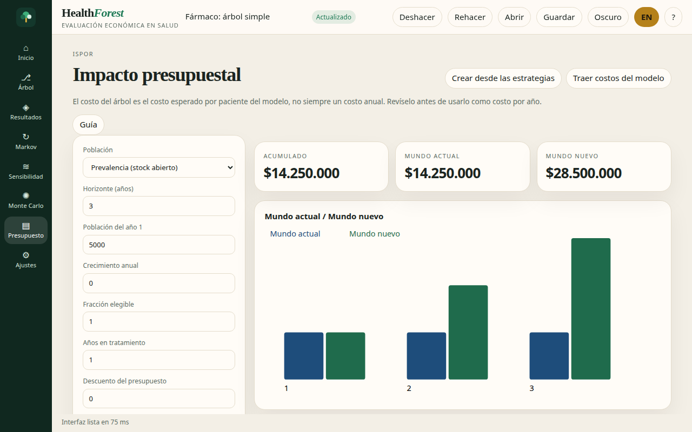

# Budget impact

Budget impact is not an ICER. It asks how much money moves, year by year, if a group of people shifts from what is used today to the new option.

1. Open the decision example, or build your own strategies.
2. Open **Budget**.

3. Choose prevalence (people already in care) or incidence (people who arrive each year).
4. Enter the population, the growth and the years.
5. Check the annual cost of each strategy. If you came from a tree, you can bring in the cost the model already calculated.
6. In the current world and the new world, enter the share of each strategy in each year. Each row should add up to 1.
7. The chart compares spending in the two worlds. The difference is the impact.

**Budget simulation** repeats the calculation with the distributions you set, so you see a range instead of a single number.

If you also have a Markov model, the **Markov** screen can export the cost of each cycle. That table is the budget input when cost changes over time.
