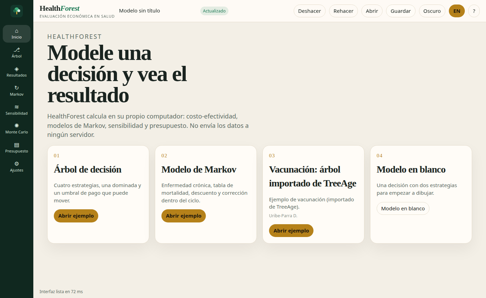
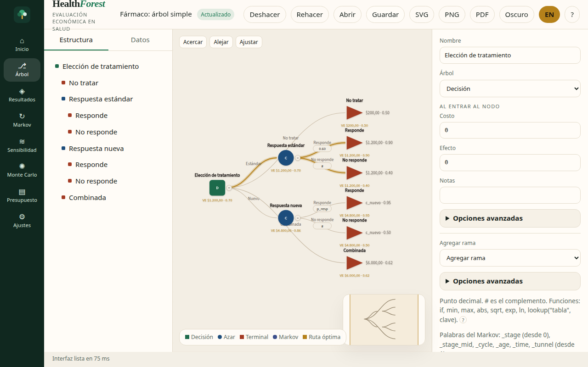
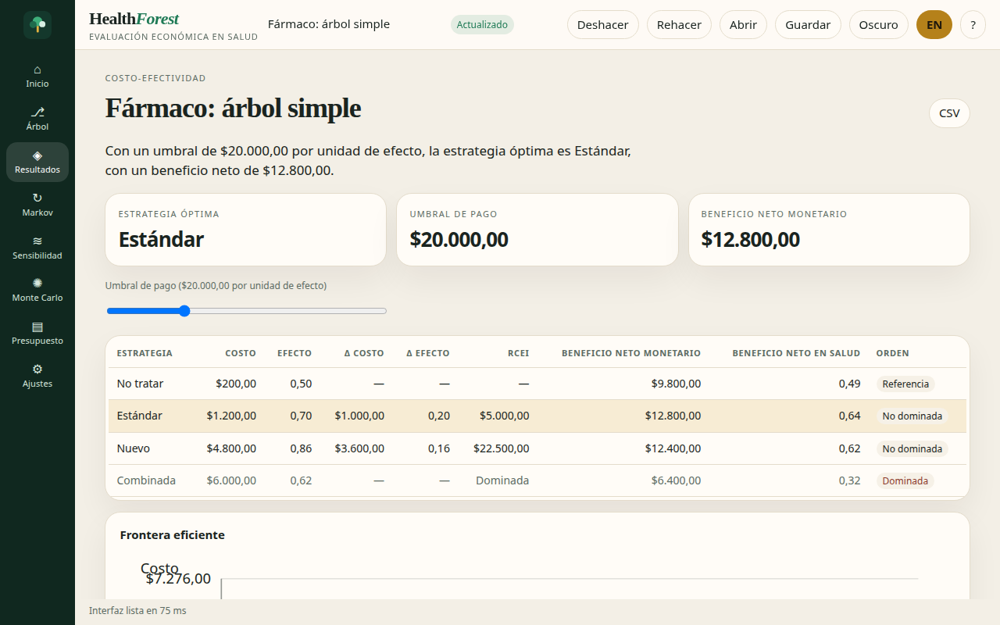

# Your first tree in 5 minutes

You will open an example, change one number and read the result.

1. Open HealthForest (online, the installer, or `Abrir HealthForest.html`).
2. If the tour appears, read it or click **Skip**. You can open it again with **?**.

3. On **Decision tree**, click **Open example**.
4. You are on the tree. A green square is a decision, a circle is a chance and a point is an outcome.

5. Click the **Decision** node. The name and the branches are on the right.
6. Click a probability. Change it, for example from `0.6` to `0.7`. On the other branch of that chance, leave `#`. HealthForest fills in whatever is needed to reach 1.
7. Click **Results** in the left bar.

Each strategy shows its cost, its effect and the ICER. The highlighted strategy is the one that fits the willingness-to-pay threshold at the top. Move that slider and the choice can change.

8. Click **Save**. A `.healthforest.json` file downloads. **Open** loads it again.

If a number turns red, the formula was not understood. Check brackets and commas. Functions are written as `discount(1000, 0.03, 5)`.
