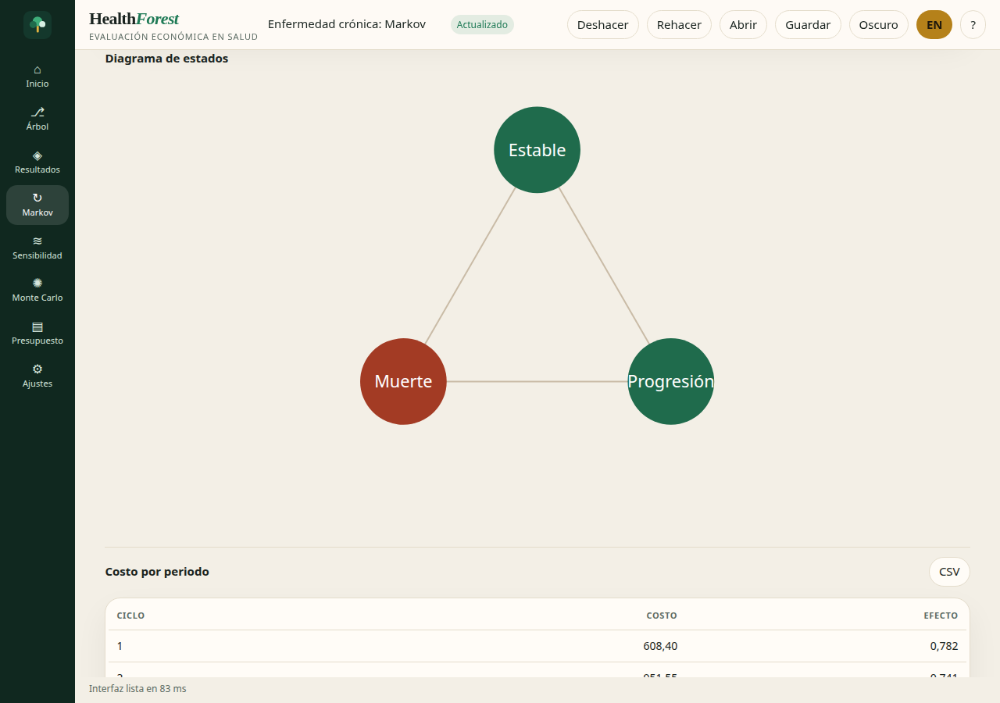

# Markov model

A Markov model follows a group of people cycle by cycle. Each person is in a state (for example stable, progression or dead) and can move.

1. On the welcome screen, open the **Markov model** example.
2. Open **Markov**.

At the top you see the accumulated cost and effect, and how many cycles the model ran. The area chart is the cohort: how much of it sits in each state in each cycle. The table below is one row per cycle.

3. Further down is the **state diagram**: one circle per state and a line for each possible step.

4. **Cost by period** adds the cost and the effect of each cycle. **CSV** downloads that table for a spreadsheet.
5. **Partitioned survival** is another way to do this when you have two curves: progression-free survival and overall survival. Change the PFS and OS numbers and the chart updates. The area between the curves is time after progression.

To build your own, open **Markov** without an example and use the guide on that screen: pick a preset, the number of cycles and the discount rate, then apply.

Inside a Markov node you can use `_stage` (the cycle, starting at 0) and `_age`. A table is read as `mortality[age]`.
