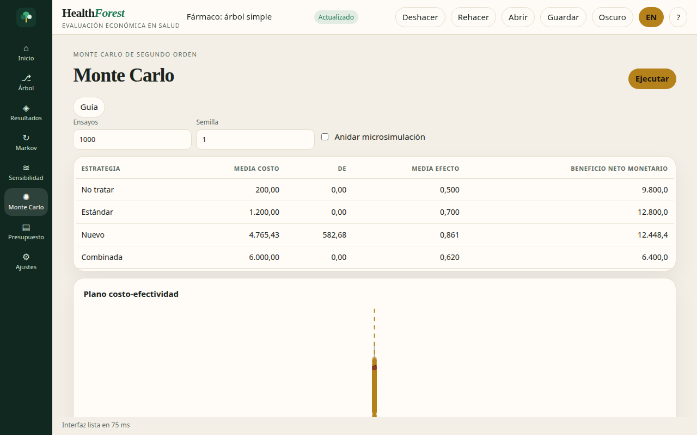

# Monte Carlo, CEAC and EVPI

The base case uses one number for each variable. Monte Carlo repeats the model many times, each time with a fresh draw, so you can see how much uncertainty there is.

1. Open an example and go to **Monte Carlo**.
2. Pick a variable and give it a distribution. There are shortcuts for a probability (beta) and for a cost (gamma).
3. Set the number of repetitions. One thousand is enough to see the shape. Ten thousand is steadier.
4. Click **Simulate**. The bar moves and you can cancel. The work runs on a side thread, so the screen does not freeze.

What to look at:

- The **plane** is one point per repetition. The horizontal axis is the incremental effect and the vertical axis is the incremental cost. The line is your willingness to pay.
- The **CEAC** says, for each threshold, in what fraction of the repetitions that strategy is preferred.
- The **CEAF** marks, at each threshold, which strategy wins most often.
- **EVPI** is the expected value of perfect information: what you would pay, per patient, to remove all the uncertainty.
- **EVPPI** is the same thing for one parameter. It is a grouped estimate, not TreeAge's exact calculation.

The seed makes the same run produce the same numbers. Change it if you want a different draw.
