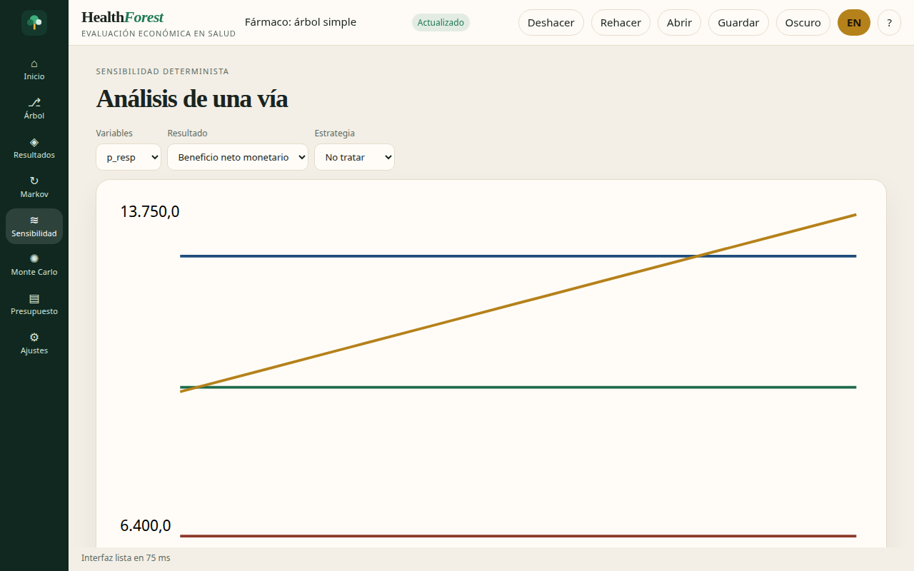

# Sensitivity and the tornado

Sensitivity answers one question: if I change a number, does the decision change?

1. Open the **Decision tree** example.
2. Open **Data** (the tab next to Outline, on the tree) or **Sensitivity**.
3. Each variable can have a low value and a high value. Those ends are the tornado's range.

4. On **Sensitivity**, pick the variable and the outcome (net monetary benefit, cost, effect or ICER).
5. The line shows how the outcome moves between the low and the high value.
6. The **tornado** stacks every variable. The longest bar moves the outcome the most.
7. If two variables have a range, the two-way grid appears.
8. The threshold, when there is one, is the value of the variable where two strategies tie.

If a variable is missing from the tornado, check that it has a low and a high value, and that some formula uses it.
