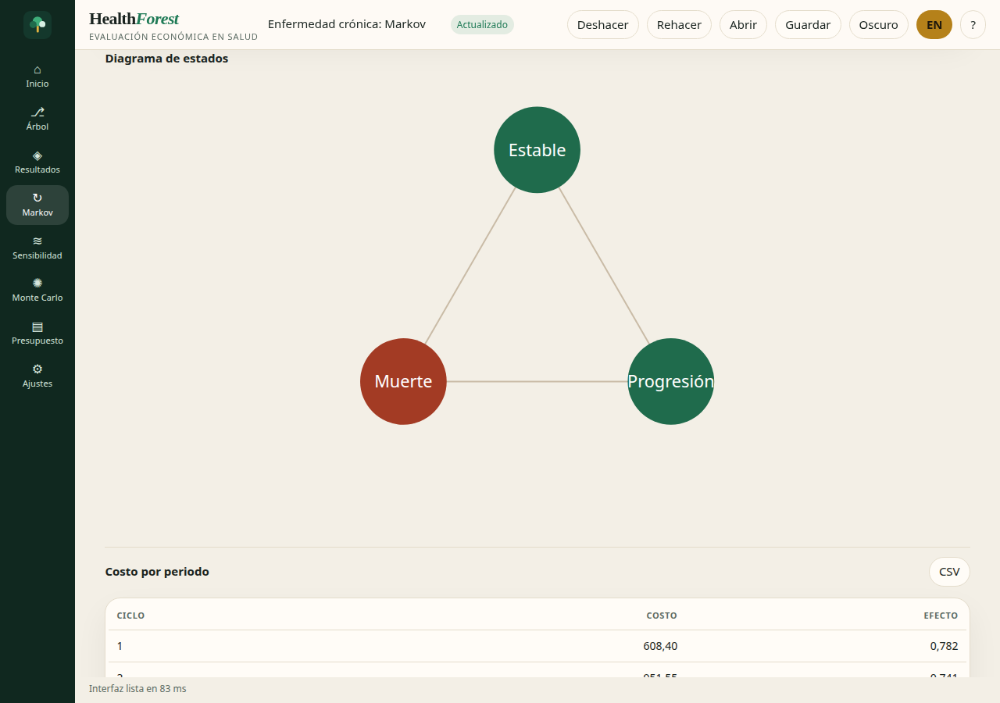

# Modelo de Markov

Un Markov sigue a un grupo de personas ciclo a ciclo. Cada persona está en un estado (por ejemplo estable, progresión o muerte) y puede cambiar.

1. En la portada, abre el ejemplo **Modelo de Markov**.
2. Entra a **Markov**.

Arriba ves el costo y el efecto acumulados, y cuántos ciclos corrió el modelo. El gráfico de áreas es la cohorte: qué parte está en cada estado en cada ciclo. Debajo está la tabla, ciclo por ciclo.

3. Más abajo está el **diagrama de estados**: un círculo por estado y una línea por cada paso posible.

4. La tabla **Costo por periodo** suma el costo y el efecto de cada ciclo. **CSV** descarga esa tabla para llevarla a una hoja de cálculo.
5. **Supervivencia particionada** es otra forma de hacer lo mismo cuando tienes dos curvas: supervivencia libre de progresión y supervivencia global. Cambia los números PFS y OS y el gráfico se actualiza. El área entre las curvas es el tiempo con progresión.

Para armar el tuyo, entra a **Markov** sin ejemplo y usa la guía de la propia pantalla: elige un esquema, el número de ciclos y la tasa de descuento, y pulsa aplicar.

En un nodo de Markov puedes usar `_stage` (el ciclo, desde 0) y `_age`. Una tabla se consulta así: `mortalidad[edad]`.
