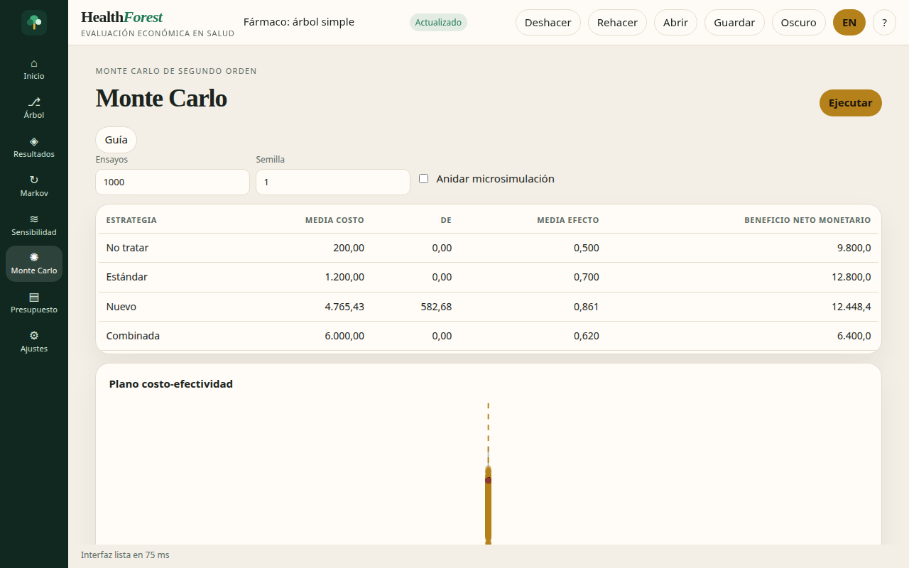

# Monte Carlo, CEAC y EVPI

El caso base usa un solo número para cada variable. El Monte Carlo repite el modelo muchas veces, cada vez con un sorteo, para ver cuánta incertidumbre hay.

1. Abre un ejemplo y entra a **Monte Carlo**.
2. Elige una variable y asígnale una distribución. Hay atajos para una probabilidad (beta) y para un costo (gamma).
3. Escribe el número de repeticiones. Mil suele bastar para mirar la forma. Diez mil es más estable.
4. Pulsa **Simular**. La barra avanza y puedes cancelar. El trabajo corre en un hilo aparte: la pantalla no se congela.

Qué mirar:

- El **plano** es un punto por repetición. El eje horizontal es el efecto incremental y el vertical es el costo incremental. La línea es tu umbral de pago.
- La **CEAC** dice, para cada umbral, en qué fracción de las repeticiones esa estrategia es la preferida.
- La **CEAF** marca, en cada umbral, cuál estrategia gana más a menudo.
- El **EVPI** es el valor esperado de la información perfecta: cuánto pagarías, por paciente, por quitar toda la incertidumbre.
- El **EVPPI** es lo mismo, pero solo para un parámetro. Es una estimación por grupos, no el cálculo exacto de TreeAge.

La semilla hace que la misma corrida dé los mismos números. Cámbiala si quieres otro sorteo.
