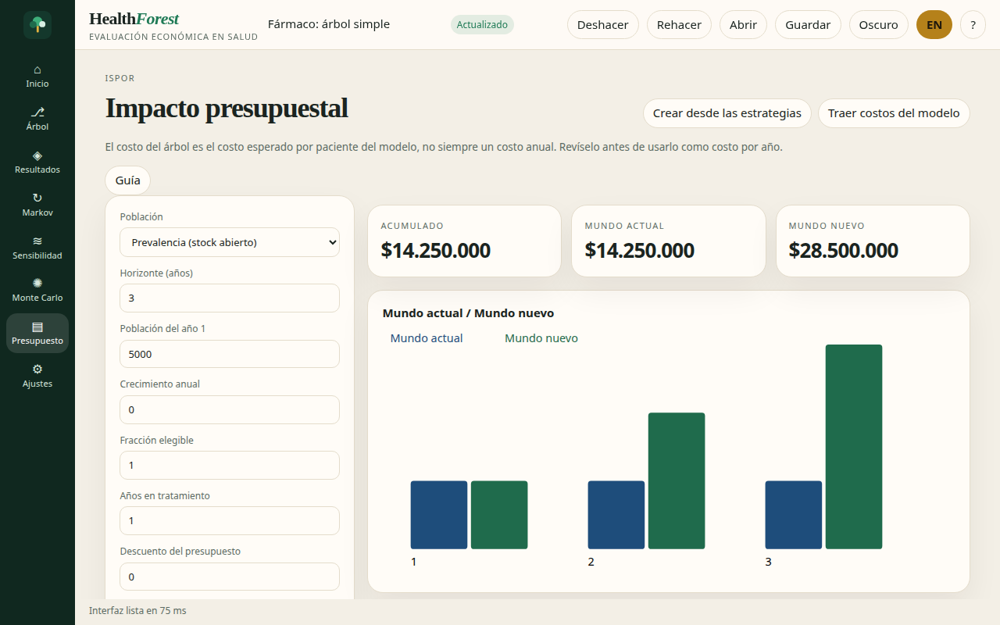

# Impacto presupuestal

El impacto presupuestal no es un RCEI. Pregunta cuánto dinero se mueve, año a año, si un grupo de personas pasa de lo que se usa hoy a lo nuevo.

1. Abre el ejemplo de decisión o arma tus estrategias.
2. Entra a **Presupuesto**.

3. Elige prevalencia (la gente que ya está) o incidencia (la gente que llega cada año).
4. Escribe la población, el crecimiento y los años.
5. Revisa el costo anual de cada estrategia. Si vienes de un árbol, puedes traer el costo que ya calculó el modelo.
6. En el mundo actual y en el mundo nuevo, escribe qué parte usa cada estrategia en cada año. Cada fila debería sumar 1.
7. El gráfico compara el gasto de los dos mundos. La diferencia es el impacto.

**Simulación del presupuesto** repite el cálculo con las distribuciones que hayas puesto, para ver un rango y no un solo número.

Si además tienes un Markov, en la pantalla **Markov** puedes exportar el costo de cada ciclo. Esa tabla es el insumo del presupuesto cuando el costo cambia con el tiempo.
