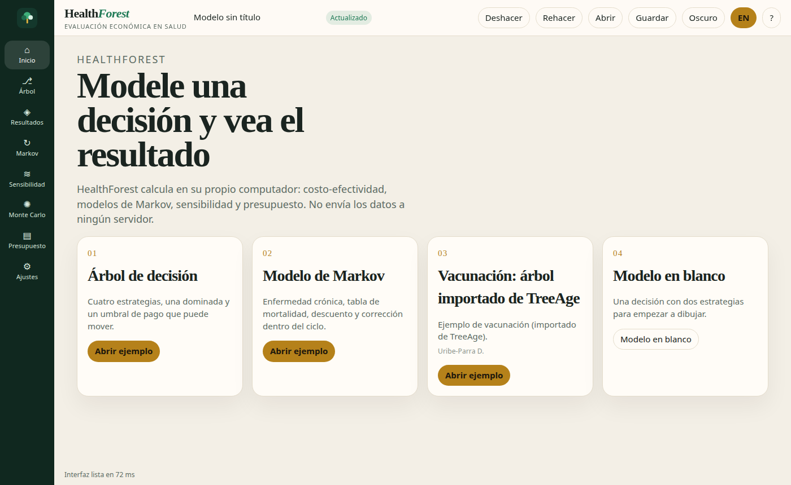
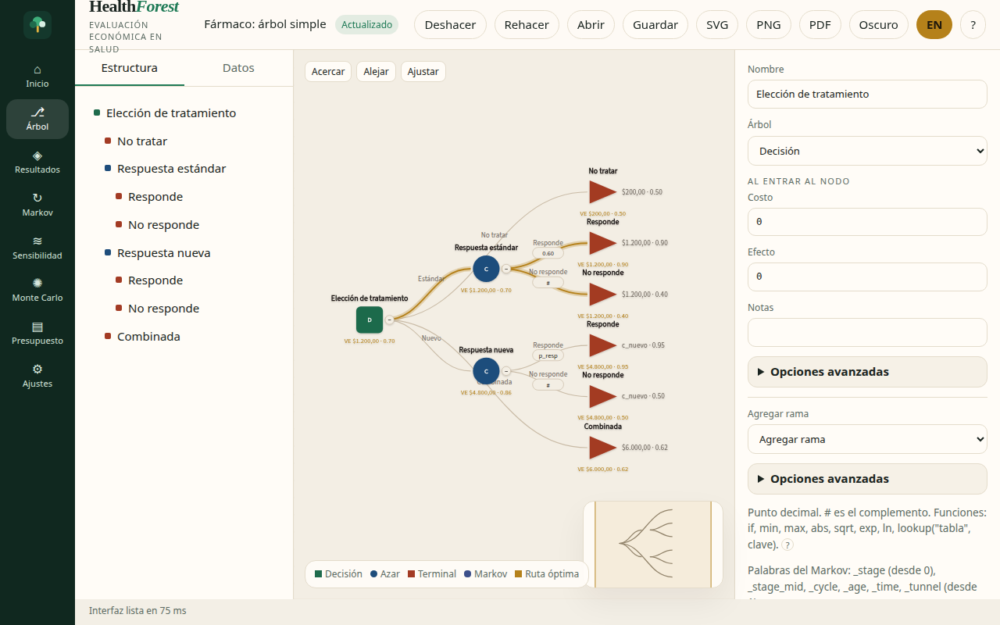
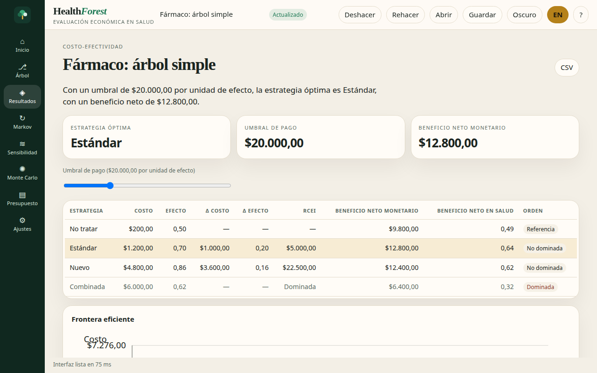

# Tu primer árbol en 5 minutos

Vas a abrir un ejemplo, cambiar un número y leer el resultado.

1. Abre HealthForest (en línea, el instalador o `Abrir HealthForest.html`).
2. Si aparece el recorrido, léelo o pulsa **Saltar**. Siempre puedes volver a él con **?**.

3. En **Árbol de decisión**, pulsa **Abrir ejemplo**.
4. Estás en el árbol. Cada cuadro verde es una decisión, cada círculo es un azar y cada punta es un desenlace.

5. Haz clic en el nodo **Decisión**. A la derecha ves el nombre y las ramas.
6. Haz clic en una probabilidad. Cámbiala, por ejemplo de `0.6` a `0.7`. En la otra rama de ese azar deja `#`: HealthForest pone lo que falta para sumar 1.
7. Pulsa **Resultados** en la barra izquierda.

Ahí ves, para cada estrategia, el costo, el efecto y el RCEI. La estrategia resaltada es la que conviene con el umbral de pago de arriba. Mueve esa barra y la elección puede cambiar.

8. Pulsa **Guardar**. Se descarga un archivo `.healthforest.json`. **Abrir** lo vuelve a cargar.

Si un número se pone en rojo, la fórmula no se entendió. Revisa paréntesis y comas. Las funciones se escriben como `discount(1000, 0.03, 5)`.
