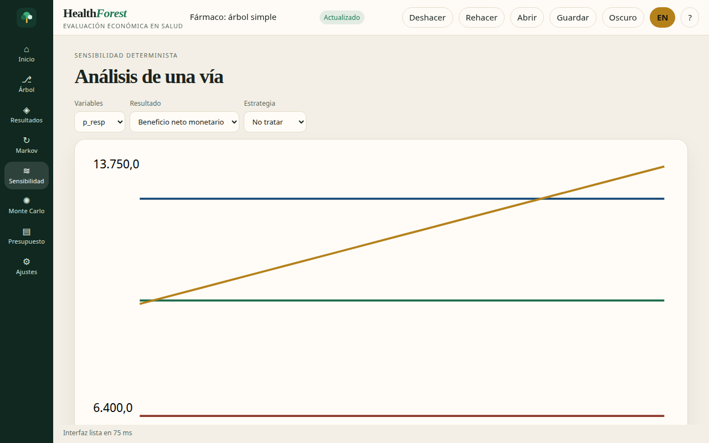

# Sensibilidad y tornado

La sensibilidad responde a una pregunta: si cambio un número, ¿cambia la decisión?

1. Abre el ejemplo **Árbol de decisión**.
2. Entra a **Datos** (la pestaña junto a Esquema, en el árbol) o a **Sensibilidad**.
3. Cada variable puede tener un mínimo y un máximo. Esos extremos son el rango del tornado.

4. En **Sensibilidad**, elige la variable y el resultado (beneficio neto, costo, efecto o RCEI).
5. La línea muestra cómo se mueve el resultado entre el mínimo y el máximo.
6. El **tornado** apila todas las variables. La barra más larga es la que más mueve el resultado.
7. Si hay dos variables con rango, aparece la rejilla de dos vías.
8. El umbral, cuando existe, es el valor de la variable en el que dos estrategias empatan.

Si una variable no sale en el tornado, revisa que tenga mínimo y máximo, y que alguna fórmula la use.
